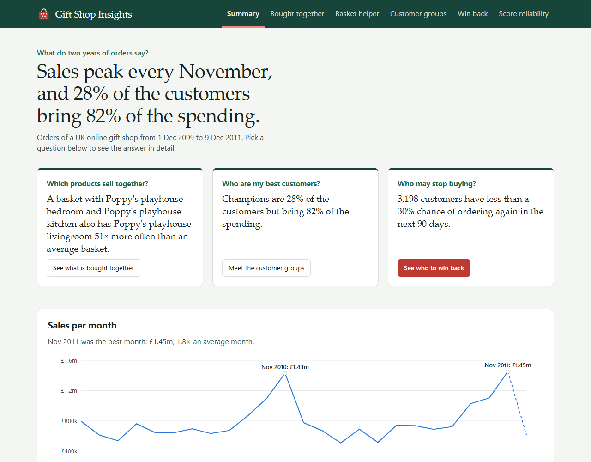
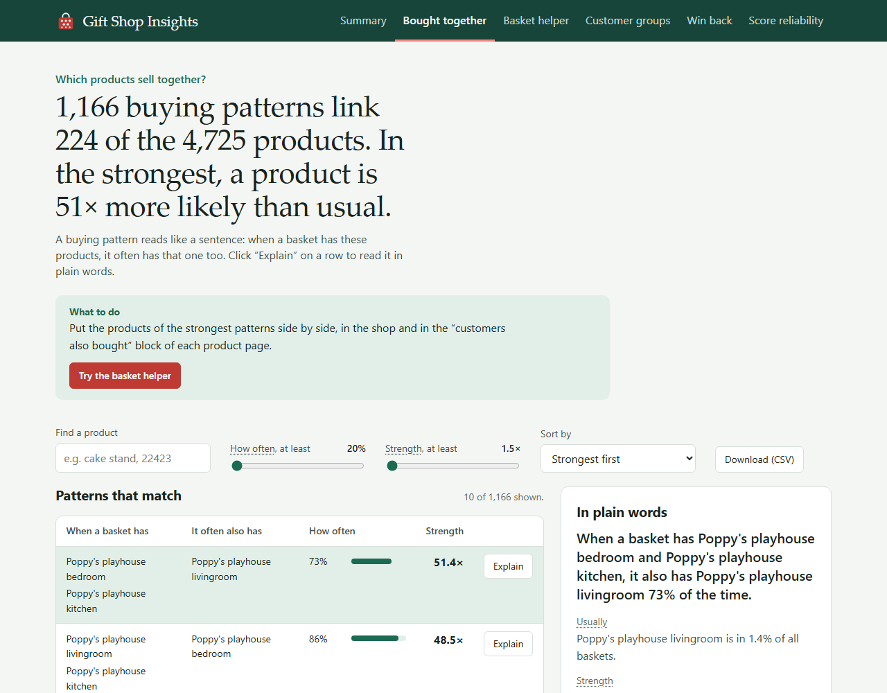
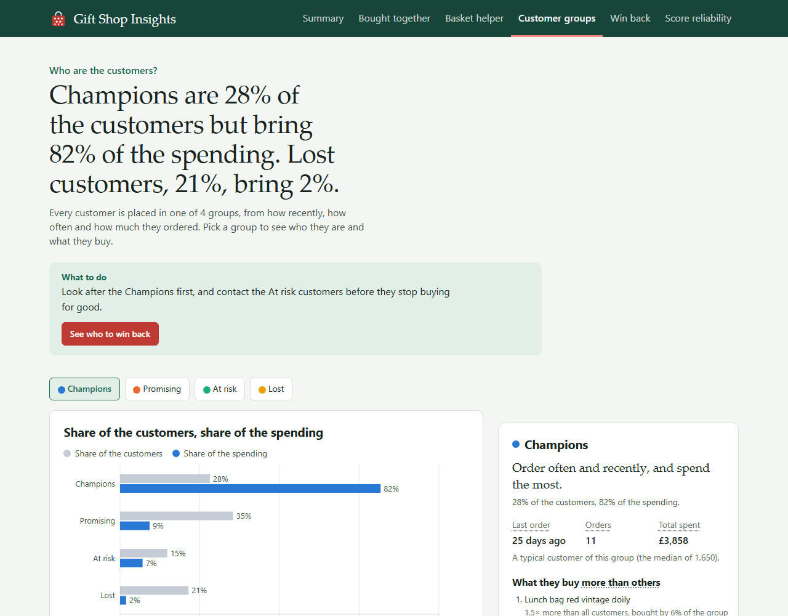
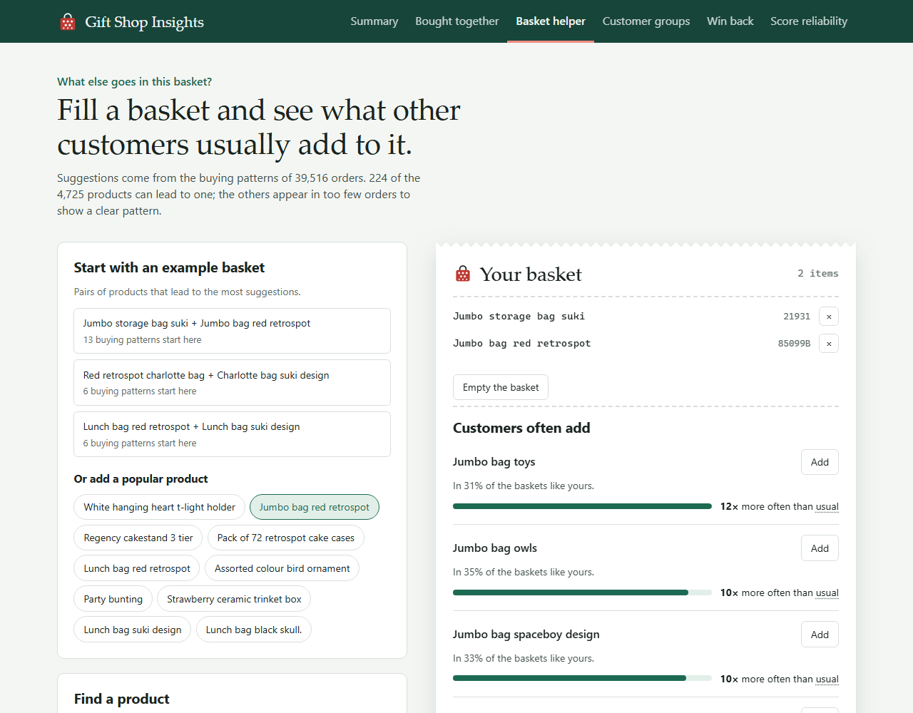
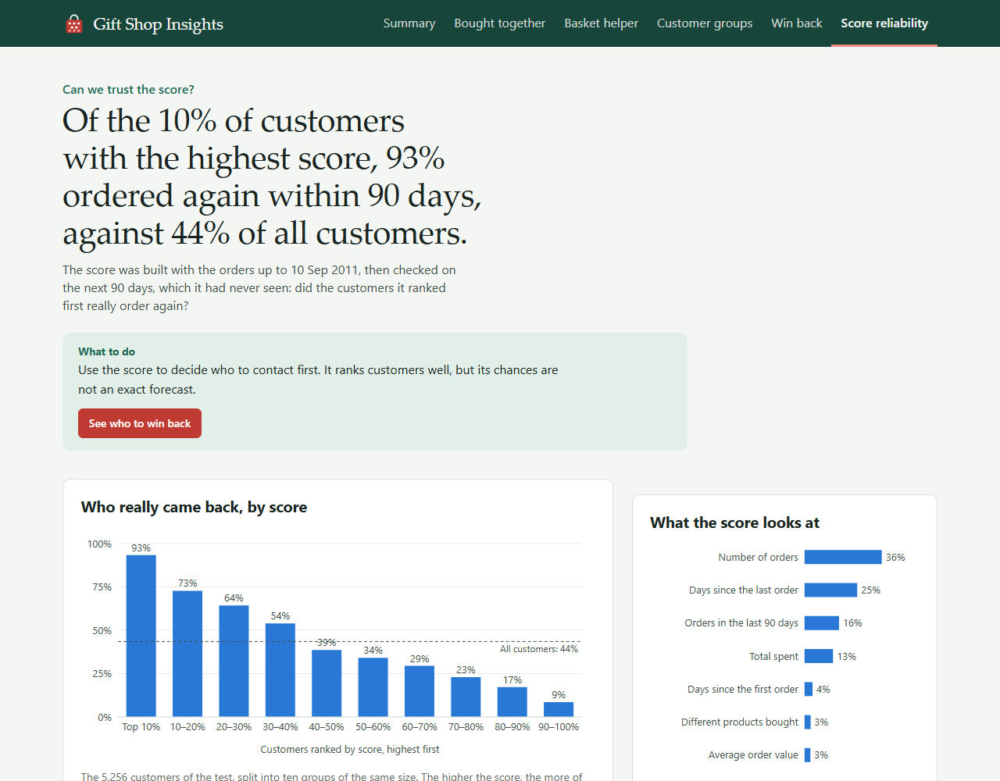
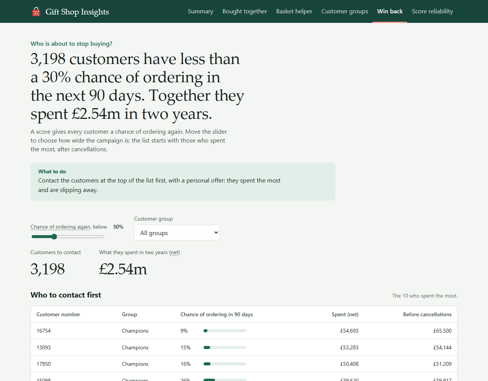
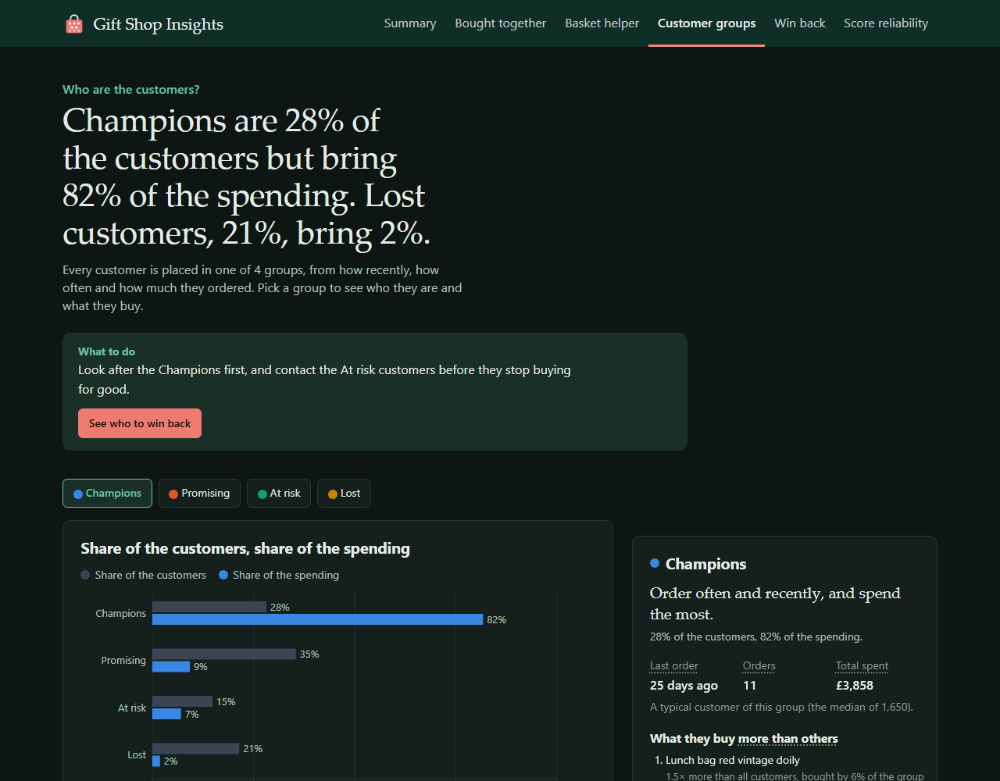
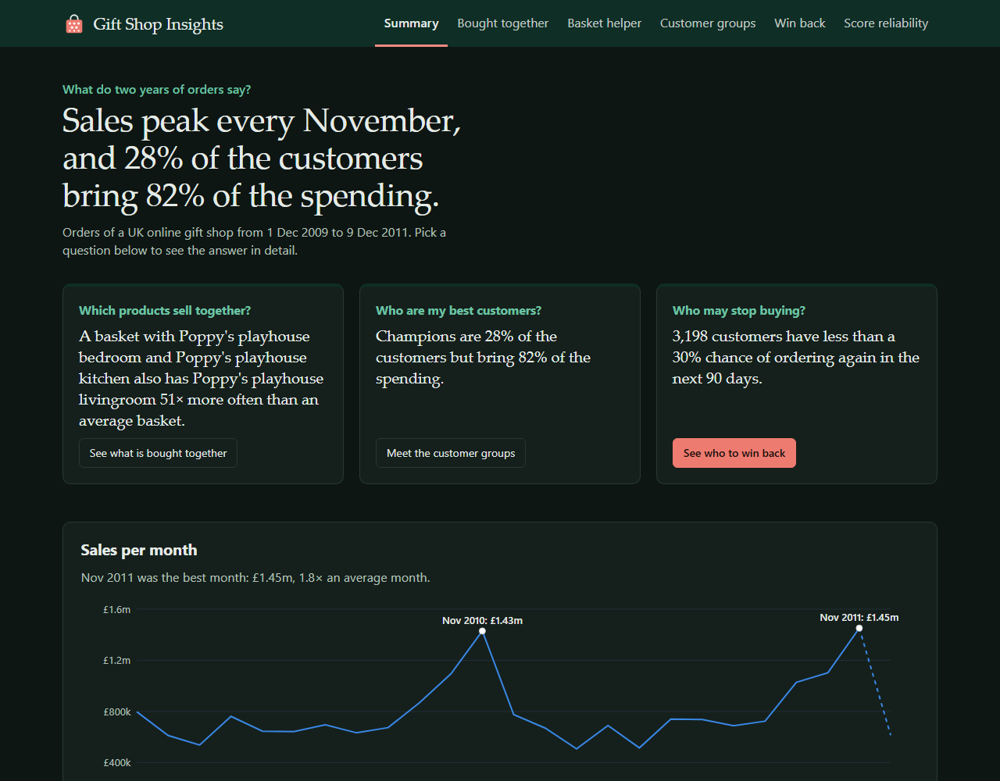
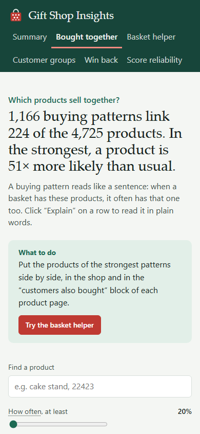
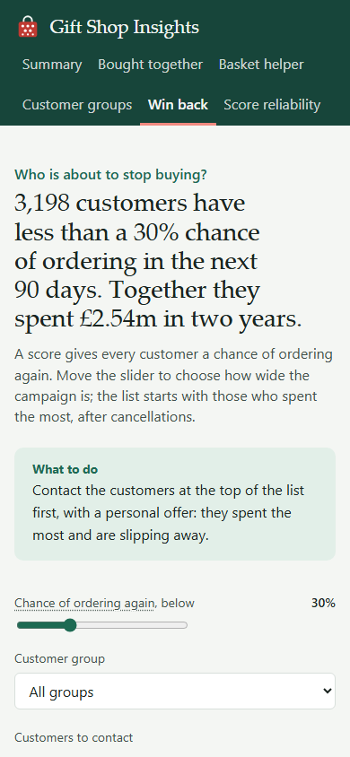

# Market Basket Analysis

[](https://github.com/badrlaaji/market-basket-analysis/actions/workflows/ci.yml)

> **Work in progress.** Steps 0 to 9 are done: data pipeline, models, REST API, web app, Docker Compose and CI, plus a redesign of the web app where each page answers one business question. AWS deployment comes next.



## Problem

An online retailer wants to answer three questions from its transaction history:

1. **Which products are bought together?** Association rules (FP-Growth) power a "customers also bought" feature.
2. **Who are our customers?** RFM features and KMeans group customers into named segments.
3. **Who will stop buying?** A model predicts each customer's probability of purchasing again within 90 days, so the team can target win-back campaigns.

The answers are served through a REST API and an interactive web app.

## Plan

- [x] 0. Repository, virtual environment, Spark smoke test
- [x] 1. Excel to Parquet ingestion
- [x] 2. Data cleaning with PySpark
- [x] 3. Association rules with FP-Growth
- [x] 4. RFM segmentation with KMeans
- [x] 5. Repurchase prediction (XGBoost vs baseline, tracked with MLflow)
- [x] 6. REST API (FastAPI) with tests and a Docker image
- [x] 7. Web interface (Next.js)
- [x] 8. Docker Compose
- [x] 9. CI with GitHub Actions
- [ ] 10. Deployment on AWS (S3 + EC2)
- [ ] 11. Final README, demo video, `v1.0`

## Architecture

```
OFFLINE   python -m pipeline.run_all            (about 5 min 45 s on a laptop, Spark local[2])

  download ─► Excel ─► raw.parquet ─► cleaning ─► clean.parquet ─┬─► FP-Growth ─────► rules.parquet
              (pandas)                (PySpark)                  ├─► RFM + KMeans ──► segments.parquet, segment_profiles.parquet,
                                                                 │                    segments_k_report.json, segment_transitions.parquet
                                                                 ├─► XGBoost ───────► repurchase_scores.parquet, model_report.json
                                                                 └─► export ────────► products.parquet, stats.json,
                                                                                      monthly_sales.parquet, segment_top_products.parquet
            experiments (thresholds, k, silhouettes, AUCs) ─► MLflow, local SQLite store

ONLINE    Browser ─► Next.js pages + /api/* routes ─► FastAPI (Docker) ─► pandas DataFrames in memory
                     the browser never calls FastAPI      outputs loaded once at startup, no Spark / Java / XGBoost in the image
```

## Results

All figures are produced by the code of this repository (see `JOURNAL.md` and `DECISIONS.md`).

| Step | Result |
| --- | --- |
| Cleaning (PySpark) | 1,067,371 → 1,003,357 rows: cancellations, invalid quantity or price, 25 non-product codes and exact duplicates removed. 39,516 invoices, 4,725 products, 5,852 customers. Same count as an independent pandas implementation. |
| Association rules (FP-Growth) | minSupport 0.01, confidence ≥ 0.2, lift ≥ 1.5: 1,166 rules covering 224 products. 5 rules recomputed with pandas give identical values. |
| Segments (RFM + KMeans) | log1p on frequency and monetary, standardization, k = 4: Champions 1,650, Promising 2,076, At risk 869, Lost 1,257 customers. |
| Repurchase within 90 days | Out-of-time validation: trained on features before 2011-06-12, tested on features before 2011-09-10 (5,256 customers, 43.5 % buy again). XGBoost **PR-AUC 0.770 / ROC-AUC 0.795** vs recency baseline 0.685 / 0.762. An anti-leak test checks that purchases after the reference date never change a feature. |
| API | 16 endpoints, outputs loaded in 0.2 s, `/recommend` answers in about 9 ms (in-process test). 88 pytest tests in total. |
| CI (GitHub Actions) | 4 parallel jobs on every push: API tests with the API dependencies only, pipeline tests with Java 21 and ruff, Next.js lint and build, build of both Docker images. About 2 minutes per run. |
| Web app | 6 pages, one business question each, in plain words for non-specialists: an answer sentence generated from the data (no figure written by hand), one piece of advice, technical charts kept in a closed analyst block. Recharts only: scatter, Sankey, treemap, radar, histograms, calibration with error bars. Colours checked for colour blindness in light and dark themes. A scripted browser run of every page and tab: 0 console errors, every request sent to the Next.js server only, no horizontal scroll at 390 px. |

**Known limitations.** The segments use monetary values gross of cancellations; the win-back list sorts by net value instead, because ranked by gross value its first two customers had cancelled almost all of their orders. The probabilities are shifted by seasonality (mean prediction 0.32 vs 0.44 observed on the test period, the Christmas peak), so they are best used to rank customers. Only 224 of the 4,725 products appear in a rule.

## REST API

```bash
source .venv/bin/activate
uvicorn api.main:app --reload          # http://localhost:8000/docs (Swagger UI)
```

With Docker (the image contains the code only; the outputs are mounted read-only):

```bash
docker build -t mba-api api/
docker run -p 8000:8000 -v "$PWD/outputs:/app/outputs:ro" mba-api
curl "http://localhost:8000/rules?limit=3"
```

| Endpoint | Description |
| --- | --- |
| `GET /health` | Liveness check and size of the loaded outputs |
| `GET /rules?min_confidence=&min_lift=&product=&sort=&limit=` | Rules filtered by thresholds and by product (code or name), sorted by lift, confidence or support |
| `GET /products?q=&limit=` | Product search; an empty query returns the most bought products |
| `POST /recommend` | `{"items": [...], "k": 5}` → products to suggest, from the rules whose antecedent is in the basket; unknown codes are listed, not rejected |
| `GET /segments` | RFM profile of each segment (size, share, means and medians) |
| `GET /stats` | Key figures of the data, the rules and the model |
| `GET /at-risk?threshold=&top=&segment=` | Customers with a repurchase probability below the threshold, highest net value first (cancellations deducted); gross and net values, and the total net spend of all of them |
| `GET /rules/export?...` | Every rule matching the `/rules` filters, as a CSV file |
| `GET /scenarios` | Example baskets: the product pairs that start the most rules, no product shared |
| `GET /segments/map?n=` | A sample of customers (recency, frequency, spend, segment), each segment keeping its share; no customer ID |
| `GET /segments/grid` | Customers per recency fifth × invoice band (1, 2, 3–4, 5–9, 10+) |
| `GET /segments/k` | Silhouette for k = 2 to 8 and the k kept |
| `GET /segments/transitions` | Customers moving between segments in the last 90 days (same scaler and centers) |
| `GET /timeline` | Revenue, invoices and customers per month; partial months flagged |
| `GET /model` | Model metrics, precision-recall and ROC curves against the baseline, calibration per decile, feature importances |
| `GET /at-risk/histogram?segment=` | Customers and net spend per probability band of 0.05 |

Parameters are validated (for example `min_confidence` and `threshold` in [0, 1], `limit` ≤ 500, or ≤ 2,000 for `/rules`, at most 50 basket items); invalid values return `422`.

<!-- Swagger UI screenshots: add docs/img/swagger-*.png here -->

## Web app

```bash
uvicorn api.main:app                  # terminal 1, from the repository root
cd frontend && npm ci && npm run dev   # terminal 2, http://localhost:3000
```

`API_URL` (server side only) tells Next.js where FastAPI is: `http://localhost:8000` by default. Pages are server components that load their first data from FastAPI; interactive parts call the `/api/*` routes of Next.js, which forward to FastAPI. The FastAPI address never reaches the browser.

The app is written for shop managers, not data scientists: pages are named after the question they answer, every page opens with a sentence built from the data and one "What to do" advice, and the technical charts (scatter of rules, RFM grid, silhouette, PR/ROC curves, calibration) sit in a closed "More detail for analysts" block. The look follows the shop's own products: shopfront green, one Retrospot red for the main actions, a book serif for the answers, and a basket drawn as a till receipt.

| Page (menu) | Question | What you can do |
| --- | --- | --- |
| `/` Summary | What do two years of orders say? | Three questions with their answer and a link, monthly sales with the peaks, four key figures |
| `/rules` Bought together | Which products sell together? | Filter by product, how often and strength; read the selected pattern in plain words; CSV download. Analysts: map of every rule, flows, one product's rules both ways, distributions |
| `/basket` Basket helper | What else goes in this basket? | One-click example baskets, popular products, search; the basket as a receipt with "customers often add" and how much the basket changes the odds |
| `/segments` Customer groups | Who are the customers? | Share of customers against share of spending, a card per group (typical customer, preferred products). Analysts: recency × frequency scatter, radar, RFM grid, spending treemap, 90-day moves, silhouette per k |
| `/win-back` Win back | Who is about to stop buying? | Chance-of-ordering slider, filter by group, live counters, customers to contact first. Analysts: probability histogram |
| `/model` Score reliability | Can we trust the score? | Share of customers who came back per tenth of the score, what the score looks at, the seasonal shift explained. Analysts: precision-recall and ROC against the baseline, calibration with 95 % intervals |

| | |
| --- | --- |
|  |  |
|  |  |
|  |  |

Dark theme and phone width are supported:



 

## Run with Docker Compose

The pipeline outputs must exist in `outputs/` (run `python -m pipeline.run_all` once). Then, from the repository root:

```bash
docker compose -f infra/docker-compose.yml up -d --build   # http://localhost:3000
docker compose -f infra/docker-compose.yml ps              # api: healthy
docker compose -f infra/docker-compose.yml down
```

Only the web app publishes a port (3000). The API listens on the internal Docker network (`http://api:8000`), so it cannot be reached from the host. The web container starts once the API answers its health check. Both containers run as non-root users; `outputs/` is mounted read-only.

| Image | Size | Memory at rest |
| --- | --- | --- |
| `mba-api` (python:3.14-slim, FastAPI, pandas) | 646 MB | 150 MiB |
| `mba-web` (node:24.22.0-slim, Next.js standalone) | 386 MB | 176 MiB |

## Stack

- **Pipeline and ML:** Python 3.14, PySpark 4.2, pandas, scikit-learn, XGBoost, MLflow
- **API:** FastAPI, Uvicorn, Pydantic, Docker
- **Frontend:** Next.js 16, React 19, TypeScript, Recharts
- **Infrastructure:** Docker, GitHub Actions, AWS (S3, EC2)

## Data

[Online Retail II](https://archive.ics.uci.edu/dataset/502/online+retail+ii): 1,067,371 transactions from a UK-based online retailer, December 2009 to December 2011.
The data is not stored in this repository. Download it and run the pipeline with:

```bash
source .venv/bin/activate
python -m pipeline.run_all   # downloads the data if missing, then builds data/interim/*.parquet and outputs/
pytest -q                    # 88 tests
```

Chen, D. (2012). Online Retail II [Dataset]. UCI Machine Learning Repository. https://doi.org/10.24432/C5CG6D. Licensed under [CC BY 4.0](https://creativecommons.org/licenses/by/4.0/).

Only numeric customer IDs are displayed. No re-identification is attempted.

## License

Code released under the [MIT License](LICENSE).
